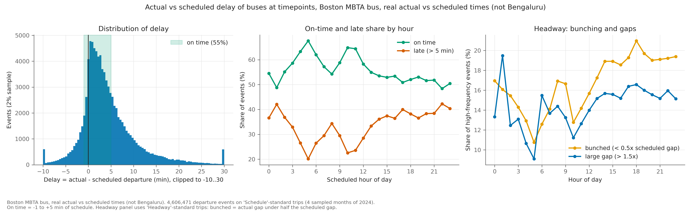
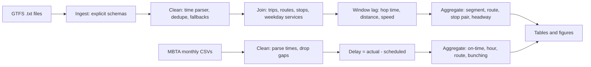
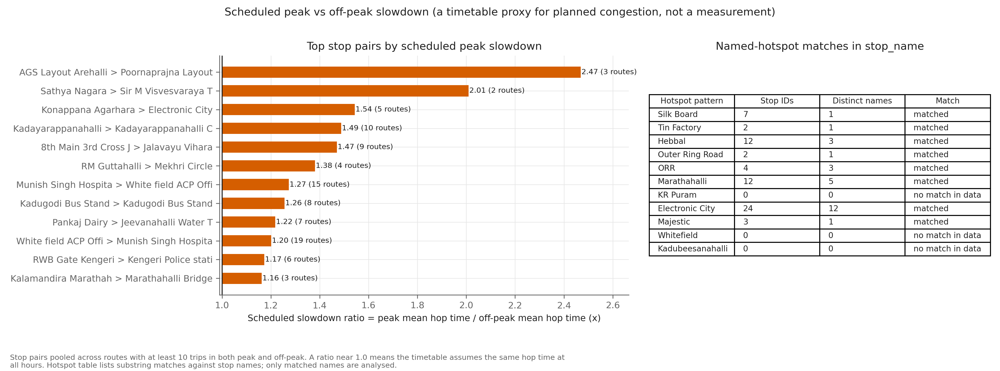
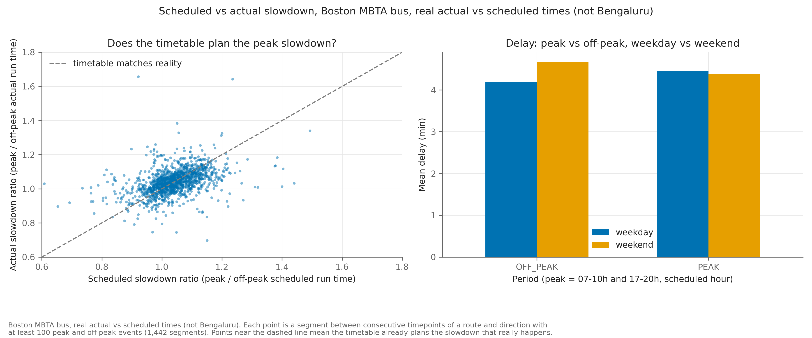

<div align="center">

# BMTC and MBTA Bus Analytics with PySpark

**Scalable route-efficiency, scheduled travel-time variability and real delay analytics for Bengaluru (BMTC), validated on Boston (MBTA) data**


*Ramaiah Institute of Technology, course CSE557 Big Data Analytics*

</div>

---

## Overview

BMTC runs thousands of buses on congested Bengaluru corridors, and planners need to know where service is slow or unreliable.
The only public BMTC data is a **static GTFS timetable**: it contains *planned* times and **no actual arrival times**, so real BMTC delay cannot be measured.
This project therefore has two parts that share one PySpark design.

| | **Part A: Bengaluru (BMTC)** | **Part B: Boston (MBTA)** |
|---|---|---|
| Data | Static GTFS timetable, 5 linked tables | Real scheduled **and** actual bus departures |
| Size | 2,238,693 `stop_times` rows | 9,108,352 events (Jan, Apr, Jul, Oct 2024) |
| Question | What does the timetable *plan*? How variable is it, and does it plan a peak slowdown? | How late are buses really, how often on time, how much bunching? |
| Result | Timetable is almost flat (about 20.8 km/h everywhere) | Mean delay 4.3 min, 55.4% on time |

> **Important.** Part B is **Boston, not Bengaluru**. BMTC publishes no actual-time data, so we show the same Spark method on a public dataset that has it.
> Boston results must never be read as BMTC performance.

## Headline results

### Part A: Bengaluru timetable (scheduled times only)
- **86.44%** of raw `stop_times` rows end up as analysed hops (1,935,039 of 2,238,693); losses are the weekday filter, the first stop of each trip and 2,997 invalid rows.
- The timetable is close to constant speed, so scheduled variability is very low: **89.6%** of ranked segments have zero peak variability and the median peak/off-peak ratio is **1.000**.
- This is a finding about the data: the source says times were interpolated by distance, and 78.85% of hops run within 5% of their trip's median speed. The feed cannot reveal planned congestion.

### Part B: Boston real delay
- 4,606,471 departure events: mean delay **4.3 min** (median 3.0, p90 11.7), **55.4% on time**, 34.1% late, 10.6% early.
- 17.2% of gaps on high-frequency routes are bunched (under half the scheduled gap) and 14.6% are large gaps (over 1.5x).
- Boston's timetable plans a peak slowdown (median scheduled ratio 1.036); BMTC's plans none (1.000).

<p align="center"></p>

### Performance (Apple M3, 8 cores, 16 GB, Spark 3.5.3)

| Cores | BMTC time (2.0M rows) | BMTC speedup | BMTC efficiency |
|---|---|---|---|
| 1 | 52.0 s | 1.00x | 1.00 |
| 2 | 39.2 s | 1.33x | 0.66 |
| 4 | 26.5 s | 1.96x | 0.49 |

| Cores | Boston time (8,424,946 events) | Speedup | Efficiency |
|---|---|---|---|
| 1 | 227.0 s | 1.00x | 1.00 |
| 2 | 127.1 s | 1.79x | 0.89 |
| 4 | 88.6 s | 2.56x | 0.64 |

Broadcast join **1.85 s** vs shuffle join **2.73 s** (join stage, 4 cores); shuffle data written 2,633,151 vs 219,268,237 bytes.
The small BMTC dataset is dominated by Spark's fixed overhead, while the larger Boston run scales better. Protocol: one process per core count, one discarded warm-up, median of timed runs, fixed Spark configuration.

### Correctness
Spark results were recomputed independently in pandas and compared: BMTC 13,148 hops and 3,375 segment groups; Boston 14,458 events recomputed from the raw CSV. All differences are below 1e-12. 13 pytest tests pass.

## Pipeline



Key techniques: explicit `StructType` schemas, a **row-count waterfall** that explains every lost row, a custom parser for GTFS times beyond 24:00:00, `Window.partitionBy(...).orderBy(...)` with `lag()`, haversine distance in pure Spark column expressions, broadcast vs sort-merge joins, `pivot` for peak vs off-peak, and Parquet for intermediate data.

<p align="center">
<br>

</p>

More figures are in [`outputs/figures/`](outputs/figures/): waterfall, distributions, feeder vs trunk, speedup charts and a synthetic scale-up test.

## Quick start

**Prerequisites:** Java 11 or 17 (`java -version`) and Python 3.10 to 3.12 (PySpark 3.5 does not support 3.13).

```bash
git clone https://github.com/nik1taa28/bda-project.git
cd bda-project
python3.11 -m venv .venv && source .venv/bin/activate
pip install -r requirements.txt
./run_all.sh              # full run: download, analyse, test, benchmark, figures, docs (over an hour)
```

Faster options: `SYNTHETIC=0 ./run_all.sh` skips the long synthetic scale-up test; `DELAY=0 ./run_all.sh` skips the Boston part.

| Step | Command | Approx. time |
|---|---|---|
| Download BMTC GTFS (93 MB zip) | `python scripts/download_data.py` | seconds |
| BMTC pipeline | `python -m src.pipeline --service-day weekday` | about 1 min |
| Download Boston data (315 MB zip) | `python scripts/download_delay_data.py` | a few min |
| Boston delay pipeline | `python -m src.delay_pipeline` | about 8 min |
| Tests | `pytest -q` | seconds (run the pipelines first) |
| Benchmarks | `python -m src.benchmark [--synthetic] [--with-delay]` | long |
| Figures and docs | `python -m src.viz && python -m src.make_docs` | seconds |

If a download is blocked, place `bmtc.zip` in `data/raw/` (or the MBTA zip as `data/raw_delay/mbta_bus_2024.zip`) and re-run. Nothing is ever fabricated. All thresholds (peak windows, speed cap, on-time window, minimum trips) live in [`config.yaml`](config.yaml).

## Data

| | BMTC (Bengaluru) | MBTA (Boston) |
|---|---|---|
| Source | [Vonter/bmtc-gtfs](https://github.com/Vonter/bmtc-gtfs), unofficial GTFS from the Namma BMTC 2.0 app | [MBTA Open Data Portal](https://mbta-massdot.opendata.arcgis.com/datasets/96c77138c3144906bce93d0257531b6a), "MBTA Bus Arrival Departure Times 2024" |
| Coverage used | one timetable snapshot downloaded 2026-11-16 (feed valid 2026-11-09 to 2027-11-09); weekday services only | 4 months of 2024: Jan, Apr, Jul, Oct |
| Licence | ODbL (from the repository LICENSE) | CC0 (shown on the item) |
| One row | a bus trip visiting a stop (planned times) | a bus trip leaving a timepoint (scheduled and actual) |

Neither dataset contains personal data. Details, checksums and quality profiles: [`DATA_CARD.md`](DATA_CARD.md) and [`DATA_CARD_DELAY.md`](DATA_CARD_DELAY.md).

## Repository layout

```
.
├── config.yaml            thresholds, peak windows, paths, delay settings
├── run_all.sh             end-to-end runner
├── requirements.txt       pinned dependencies
├── scripts/               download_data.py, download_delay_data.py
├── src/
│   ├── gtfs_time.py       GTFS time parser (handles 25:10:00)
│   ├── ingest.py          schemas, Spark session, readers
│   ├── clean.py           cleaning rules and row-count waterfall
│   ├── features.py        haversine, hop features, filters, route class
│   ├── pipeline.py        BMTC joins, windows, aggregations
│   ├── delay_pipeline.py  Boston actual-vs-scheduled delay analysis
│   ├── benchmark.py       1/2/4-core benchmark, join comparison, scale-up
│   ├── viz.py             all figures
│   ├── profile_data.py    data profile and interpolation check
│   ├── environment.py     machine and toolchain detection
│   └── make_docs.py       generates the docs from measured outputs
├── tests/                 13 tests (parser, cleaning, hops, delay, pandas cross-checks)
├── outputs/               RESULTS.md, figures/, tables/, benchmark_results.json
└── docs/                  PROPOSAL_UPDATES.md
```

## Methodology notes

- **Hop time** = arrival at stop *i* minus departure from stop *i-1* within the same trip (`lag` over `trip_id`, ordered by `stop_sequence`).
- **Segment** = (route, direction, from stop, to stop); a stop-pair rollup across routes is also produced. Ranking needs at least 10 trips.
- **Peak** = 07:00 to 10:00 and 17:00 to 20:00; **slowdown ratio** = peak mean time / off-peak mean time; **CV** = std / mean.
- **Distance** is straight-line (haversine), so speeds are lower bounds.
- **Delay** = actual minus scheduled departure, modulo 24 h; **on time** = -1 to +5 min; **bunched** = actual gap under 0.5 of the scheduled gap.
- Feeder routes are those named `MF-*`, trunk routes are non-feeder routes of at least 30 km. This is a heuristic, not an official label.
- No machine learning is used; this is descriptive analytics.

## Limitations

The BMTC timetable is scraped and appears interpolated, so little real variability exists; no actual BMTC times are available, so no BMTC delay is claimed; distances are straight-line; the BMTC dataset is small relative to Spark's overhead; the feeder/trunk rule is a heuristic. The Boston analysis covers timepoints only, 4 sampled months, and Schedule-standard trips for delay. Full list: [`outputs/RESULTS.md`](outputs/RESULTS.md).

## Documentation

[`outputs/RESULTS.md`](outputs/RESULTS.md) full results and limitations, [`DATA_CARD.md`](DATA_CARD.md), [`DATA_CARD_DELAY.md`](DATA_CARD_DELAY.md), [`docs/PROPOSAL_UPDATES.md`](docs/PROPOSAL_UPDATES.md).

## Acknowledgements and data attribution

Contains BMTC timetable data compiled by [Vonter](https://github.com/Vonter/bmtc-gtfs) from the Namma BMTC 2.0 app, used under the ODbL; the data is unofficial and may be inaccurate. Boston bus data: Massachusetts Bay Transportation Authority via the MBTA Open Data Portal (CC0); the agency is not liable for errors in the data.
