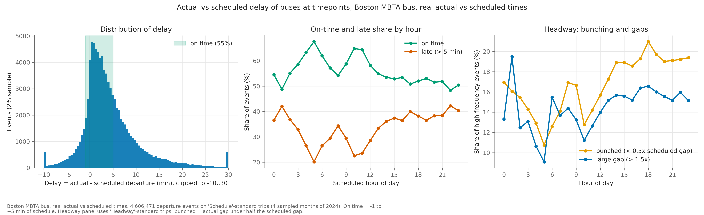
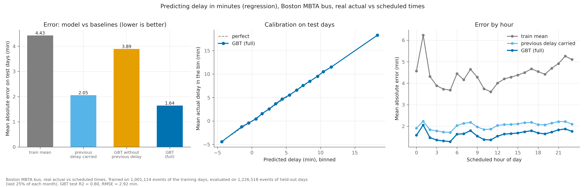
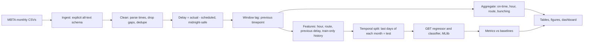
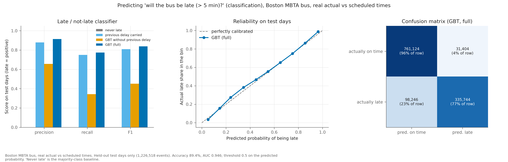
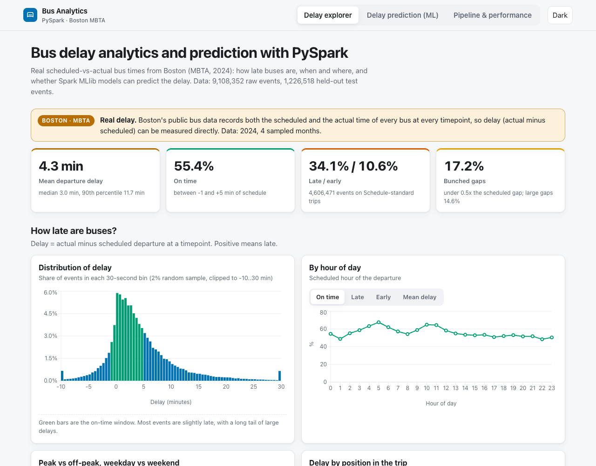
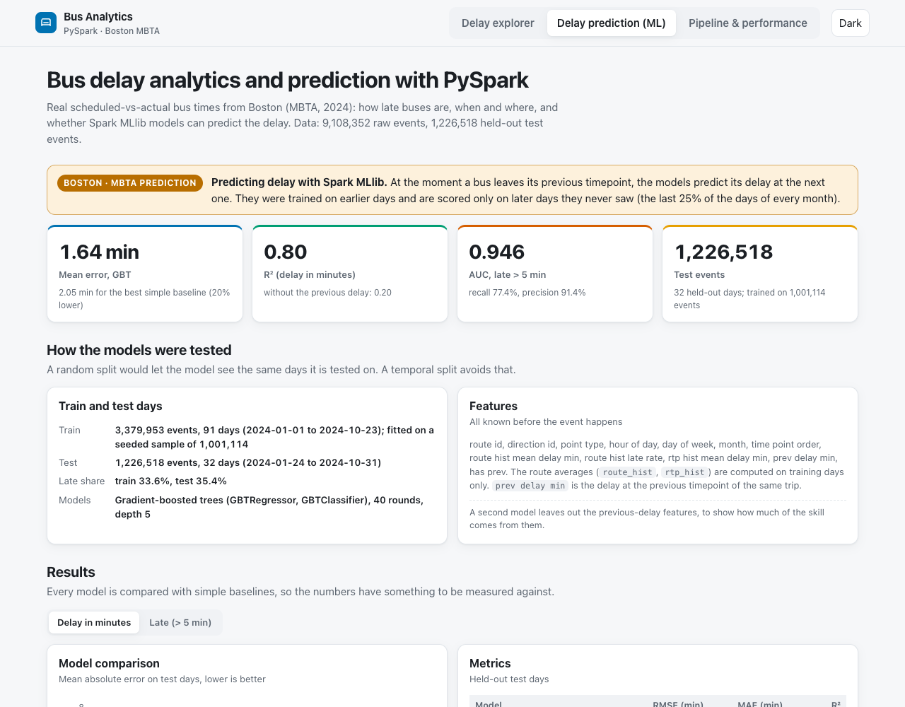
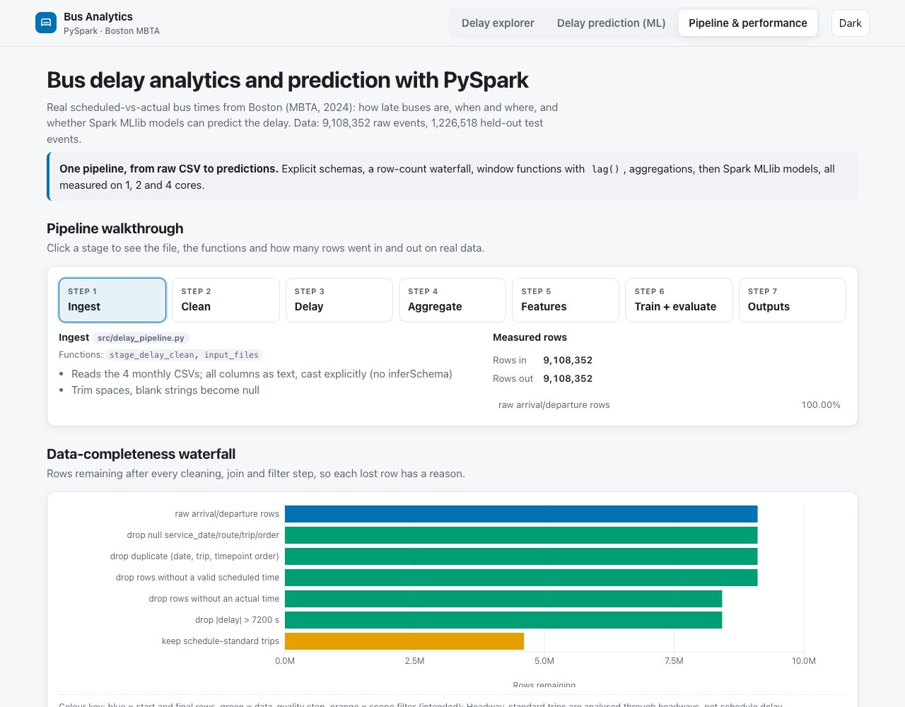

<div align="center">

# Bus Delay Analytics and Delay Prediction with PySpark

**Scalable on-time, bunching and delay-prediction analytics on Boston MBTA bus data (real scheduled vs actual times)**


*Ramaiah Institute of Technology, course CSE557 Big Data Analytics*

</div>

---

## Overview

Bus delay is hard to study at scale: every bus stop event is a row, and a single month already has tens of millions. This project uses **Apache Spark (PySpark)** to
(1) clean and analyse **9,108,352 real bus events** from the public MBTA (Boston) dataset, which records both the scheduled and the actual time of every bus at every timepoint,
(2) measure **how late buses are, when and where, and how often they bunch**, and
(3) **train and evaluate machine-learning models (Spark MLlib)** that predict the delay of a bus at its next timepoint.
It also benchmarks the pipeline and the model training on 1, 2 and 4 cores.

| | |
|---|---|
| Data | MBTA "Bus Arrival Departure Times 2024", licence CC0; months Jan, Apr, Jul, Oct 2024 |
| Size | 9,108,352 raw events, 8,424,946 after cleaning |
| Questions | How late are buses and where? Can ML predict delay better than simple baselines? How does Spark scale? |
| ML | Gradient-boosted trees: delay in minutes (regression) and late / not late (classification) |

## Headline results

### Delay analysis
- 4,606,471 departure events on Schedule-standard trips: mean delay **4.3 min** (median 3.0, p90 11.7), **55.4% on time**, 34.1% late, 10.6% early.
- 17.2% of gaps on high-frequency routes are bunched (under half the scheduled gap) and 14.6% are large gaps (over 1.5x).
- The median segment's actual peak/off-peak run-time ratio is 1.039 (scheduled: 1.036).

<p align="center"></p>

### Delay prediction (machine learning)
Held-out test days only (1,226,518 events; the last 25% of the days of every month). Training used 1,001,114 events from earlier days.

**Regression (delay in minutes)**

| model | RMSE (min) | MAE (min) | R2 |
|---|---|---|---|
| baseline: train mean | 6.477 | 4.427 | -0.002 |
| baseline: previous delay carried forward | 3.327 | 2.055 | 0.736 |
| GBT without previous delay | 5.798 | 3.892 | 0.197 |
| GBT (full features) | 2.921 | 1.643 | 0.796 |

**Classification (late = more than 5 min)**

| model | accuracy | precision | recall | F1 | AUC |
|---|---|---|---|---|---|
| baseline: never late | 0.646 | 0.000 | 0.000 | 0.000 | n/a |
| baseline: previous delay carried forward | 0.875 | 0.879 | 0.750 | 0.809 | 0.921 |
| GBT without previous delay | 0.704 | 0.657 | 0.343 | 0.451 | 0.734 |
| GBT (full features) | 0.894 | 0.914 | 0.774 | 0.838 | 0.946 |

- **Regression.** On held-out days the full GBT has MAE 1.64 min and R2 0.80, against MAE 4.43 min for predicting the training mean and 2.05 min for carrying the previous delay forward (20.1% lower MAE than the better baseline). The model is clearly better than the best simple baseline.
- **Where the skill comes from.** Without the previous-timepoint delay the GBT's MAE is 3.89 min (12.1% below the mean baseline), so schedule-only information (hour, weekday, route, timepoint) explains some of the delay; the previous delay adds the rest.
- **Classification (late = more than 5 min).** Full GBT: accuracy 89.4%, precision 91.4%, recall 77.4%, F1 0.838, AUC 0.946. Late rate in the test days is 35.4%, so accuracy alone is not informative; the carried-forward baseline reaches AUC 0.921 and without the previous delay the GBT reaches AUC 0.734.

<p align="center"></p>

### Performance (Apple M3, 8 cores, 16.0 GB, Spark 3.5.3)

| Cores | Pipeline time | Speedup | Efficiency |
|---|---|---|---|
| 1 | 217.7 s | 1.00x | 1.00 |
| 2 | 114.3 s | 1.91x | 0.95 |
| 4 | 77.9 s | 2.80x | 0.70 |

| Cores | Model training time | Speedup | Efficiency |
|---|---|---|---|
| 1 | 123.9 s | 1.00x | 1.00 |
| 2 | 75.7 s | 1.64x | 0.82 |
| 4 | 52.8 s | 2.35x | 0.59 |

Broadcast join **1.73 s** vs shuffle join **2.94 s** (local[4]); shuffle data written 147,185 vs 134,376,215 bytes.
Protocol: one process per core count, 1 timed run(s) after 0 discarded warm-up run(s) (a quick protocol, so small differences are not significant), fixed Spark configuration.

### Correctness
Spark results were recomputed independently in pandas straight from the raw CSV: 14,458 events on 6 routes, differences below 1e-6. The pytest suite also checks that the model's lag feature never uses the current or later events of a trip, that the train/test split has no date overlap, and that history features come from training days only.

## Pipeline



Key techniques: explicit schemas, a **row-count waterfall** that explains every lost row, `Window.partitionBy(...).orderBy(...)` with `lag()`, `pmod`-based midnight-safe delay,
`pivot` for peak vs off-peak, `percentile_approx`, broadcast vs sort-merge joins, Spark MLlib (`StringIndexer`, `VectorAssembler`, `GBTRegressor`, `GBTClassifier`), temporal train/test split, and Parquet for intermediate data.

<p align="center"></p>

More figures are in [`outputs/figures/`](outputs/figures/): waterfall, route delays, scheduled vs actual slowdown, feature importance and speedup charts.

## Web dashboard

An interactive React dashboard in [`webapp/`](webapp/) lets you explore the results: the delay explorer (by hour, route, position in the trip, bunching), the prediction results (model vs baselines, calibration, confusion matrix, feature importance) and the pipeline walkthrough with benchmarks. It runs from exported JSON, so it needs no Spark or Python server.

```bash
cd webapp && npm ci && npm run dev      # http://localhost:5173
```

<p align="center"></p>

<p align="center"> </p>

Regenerate its data after re-running the pipeline with `python scripts/export_webapp_data.py`. Details: [`webapp/README.md`](webapp/README.md).

## Quick start

**Prerequisites:** Java 11 or 17 (`java -version`) and Python 3.10 to 3.12 (PySpark 3.5 does not support 3.13).

```bash
git clone https://github.com/nik1taa28/bda-project.git
cd bda-project
python3.11 -m venv .venv && source .venv/bin/activate
pip install -r requirements.txt
./run_all.sh              # full run: download, analyse, model, test, benchmark, figures, docs (long)
```

| Step | Command | Approx. time |
|---|---|---|
| Download Boston data (315 MB zip) | `python scripts/download_delay_data.py` | a few min |
| Delay pipeline | `python -m src.delay_pipeline` | about 8 min |
| Train and evaluate the models | `python -m src.delay_model` | minutes |
| Tests | `pytest -q` | about a minute (run the pipeline first) |
| Benchmarks | `python -m src.benchmark [--model-only] [--skip-model]` | long |
| Figures and docs | `python -m src.viz && python -m src.make_docs` | seconds |

If the download is blocked, place the MBTA zip as `data/raw_delay/mbta_bus_2024.zip` and re-run. Nothing is ever fabricated. All thresholds (peak windows, on-time window, model settings, split) live in [`config.yaml`](config.yaml).

## Data

| | MBTA (Boston) |
|---|---|
| Source | [MBTA Open Data Portal](https://mbta-massdot.opendata.arcgis.com/datasets/96c77138c3144906bce93d0257531b6a), "MBTA Bus Arrival Departure Times 2024" |
| Coverage used | calendar year 2024, 4 months: Jan, Apr, Jul, Oct (all 12 months were downloaded) |
| Licence | CC0 (shown on the item) |
| One row | a bus trip leaving a timepoint (scheduled and actual time) |

No personal data. Details and checksums: [`DATA_CARD_DELAY.md`](DATA_CARD_DELAY.md).

## Repository layout

```
.
├── config.yaml            thresholds, peak windows, paths, delay and model settings
├── run_all.sh             end-to-end runner
├── requirements.txt       pinned dependencies
├── scripts/               download script and export_webapp_data.py
├── src/
│   ├── ingest.py          Spark session and config loading
│   ├── waterfall.py       row-count waterfall
│   ├── features.py        peak / off-peak time buckets
│   ├── delay_pipeline.py  ingest, clean, delay, window and aggregations
│   ├── delay_model.py     features, temporal split, GBT models, metrics
│   ├── tables.py          result-table writer
│   ├── benchmark.py       1/2/4-core benchmark, model-training benchmark, join comparison
│   ├── viz.py             all figures
│   ├── environment.py     machine and toolchain detection
│   └── make_docs.py       generates the docs from measured outputs
├── webapp/                React + TypeScript dashboard (reads exported JSON)
├── tests/                 tests (delay pipeline, model, dashboard export)
├── outputs/               RESULTS.md, figures/, tables/, benchmark_results.json, ml_results.json
└── docs/                  PROPOSAL_UPDATES.md
```

## Methodology notes

- **Delay** = actual minus scheduled departure at a timepoint, modulo 24 h; **on time** = -1 to +5 min; **bunched** = actual gap under 0.5 of the scheduled gap.
- **Peak** = 07:00 to 10:00 and 17:00 to 20:00 by scheduled hour; **slowdown ratio** = peak mean run time / off-peak mean run time.
- **Prediction target**: delay in minutes (regression) and late = delay over 5 min (classification), on Schedule-standard trips.
- **Split**: the last 25% of the days of each month are the test set; features use only information available before the event.
- **Baselines**: train mean, previous delay carried forward, never late. An ablation removes the previous-delay feature.

## Limitations

Boston data only, timepoints only, 4 sampled months of 2024, Schedule-standard trips only, next-timepoint prediction (uses the previous timepoint's delay), local single-machine benchmarks. Full list: [`outputs/RESULTS.md`](outputs/RESULTS.md).

## Documentation

[`outputs/RESULTS.md`](outputs/RESULTS.md) full results and limitations, [`DATA_CARD_DELAY.md`](DATA_CARD_DELAY.md), [`docs/PROPOSAL_UPDATES.md`](docs/PROPOSAL_UPDATES.md).

## Acknowledgements and data attribution

Boston bus data: Massachusetts Bay Transportation Authority via the MBTA Open Data Portal (CC0); the agency is not liable for errors in the data.
